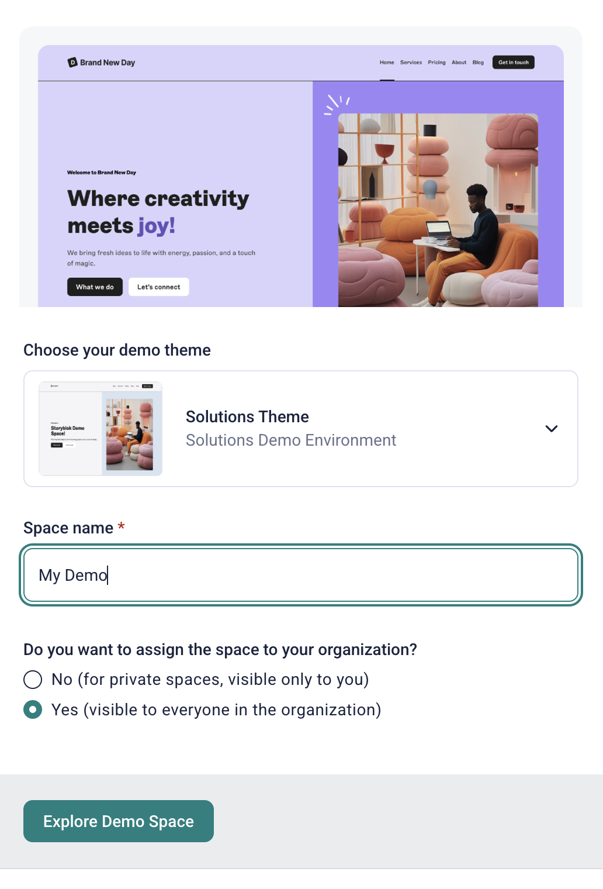

# Storyblok Solution Engineers Demo

This frontend is used when you [create a new demo space (for **Solution Engineers**) in Storyblok](https://app.storyblok.com/#/me/spaces/new?tab=experience-demo). It is built using [Nuxt 4](https://nuxt.com/) and [TailwindCSS](https://tailwindcss.com/).

> The repository is <https://github.com/storyblok/storyblok-demo-default-se> . It is a forked repository from the JoyFul Demo <https://github.com/storyblok/storyblok-demo-default-v2>

Feel free to explore and reuse the code, but please be aware of the [demo-specific implementation practices](#demo-specific-implementation-notes), which deviate from the most common implementation practices.

## Choose the right demo workflow

There are three common workflows for this Base Demo:

- Create a new Base Demo space when you only need to customize content and
  Storyblok space configuration.
- Create a new Base Demo space and run this frontend locally when you need
  prospect-specific custom components.
- Propose a new reusable component for the shared Base Demo so other developers
  and SEs can use it in future spaces.

Use the smallest workflow that can tell the right story for the prospect. Most
demos do not need frontend changes. Start with content, branding, and space
configuration first, then move to custom frontend work only when the existing
components cannot express the scenario clearly.

For example, if a customer needs a demo with their own logo, fonts, colors, and
a few marketing pages built from components that already exist in the Base Demo,
create a new Base Demo space and configure the content there. In that case, the
work belongs in Storyblok: update `site-config`, upload brand assets, adjust
navigation, create the pages, and compose them with the existing components.

If the customer story requires a component or interaction that does not exist
yet, first ask whether that component helps the customer understand the value of
Storyblok or the platform more clearly. If the answer is no, keep the demo
focused and use existing blocks. If the answer is yes, build it locally for that
specific demo space.

Before the component becomes part of the shared Base Demo, ask one more
question: can this prospect-specific component be made flexible and generic
enough to help other customers in the same segment, industry, or business
scenario? If yes, propose it as a reusable Base Demo component. If no, keep it
as local demo work for that prospect only.

## Create a new Base Demo space

You do not need to clone, install, or deploy this repository to create a new SE
demo instance. Storyblok creates a new demo space with demo content and points
it at the shared deployed frontend.

1. Go to <https://app.storyblok.com/#/me/spaces/new?tab=experience-demo>

2. Under **Choose your demo theme**, select **Solutions Theme** (`Solutions Demo Environment`).

3. Fill in the **Space name**, for example `My Demo`.

4. For **Do you want to assign the space to your organization?** choose **Yes (visible to everyone in the organization)**. This is the important one: it puts the space in the Storyblok demo Organization, which is on the **Elite plan**, so the space gets all Elite features. It also means colleagues can open and reuse it. Picking **No** creates a private space outside that organization, without the Elite plan.

5. Click **Explore Demo Space**.

The filled-in form looks like this:



The space is created with demo content already in place and pointing at the
deployed frontend, so there is nothing else to configure for the default demo
flow. Open the generated space and start from the **Home** story.

Use this workflow when you need to customize content and space configuration
only, for example:

- changing colors, fonts, header navigation, footer content, and other global
  options in the `site-config` story;
- creating roles and permissions;
- configuring custom workflows;
- uploading assets;
- changing content, folders, datasources, languages, or Visual Editor settings.

Typical use cases:

- a retail prospect wants the demo to use their logo, campaign colors, web font,
  navigation labels, and product imagery;
- a SaaS prospect needs a few campaign landing pages using existing hero, card,
  teaser, grid, and call-to-action components;
- an enterprise prospect wants to see approval workflows, roles, permissions,
  localization, or Visual Editor configuration in a space that feels like their
  organization;
- the demo needs different content structure, folders, datasources, or example
  entries, but the frontend rendering can stay the same.

If you need to set or repair the Visual Editor preview URL manually, use:

```text
https://storyblok-demo-default-se.netlify.app/?token=YOURSPACEPREVIEWACCESSTOKEN&path=
```

Replace `YOURSPACEPREVIEWACCESSTOKEN` with the space's Preview access token
from `Settings > Access Tokens`, then add the URL in
`Settings > Visual Editor > Location` or through **Add Preview URLs**.

### Use a custom preview URL

A small variation of the default workflow is creating a Base Demo space but
pointing the Visual Editor at a different frontend URL. In that case, remove the
default demo option from `Settings > Maintenance Mode > Enable example mode`
and configure a new preview URL in `Settings > Visual Editor > Location` or
through **Add Preview URLs**.

Use the same query-parameter pattern:

```text
https://YOUR-FRONTEND-URL/?token=YOURSPACEPREVIEWACCESSTOKEN&path=
```

Replace `YOUR-FRONTEND-URL` with your deployed or local frontend URL, and
replace `YOURSPACEPREVIEWACCESSTOKEN` with the space's Preview access token.

## Create a Base Demo with custom components

Use this workflow when a prospect demo needs frontend behavior or presentation
that does not exist in the shared Base Demo yet. In this case, create the demo
space first, then run this frontend locally while building and testing the
custom component.

Use this path only when existing components cannot support the story you need
to tell. Good examples are:

- a financial-services prospect needs a rate-comparison table with editor-
  controlled rows, disclosures, and responsive behavior;
- a travel prospect needs an interactive itinerary component where editors can
  manage days, stops, images, and calls to action;
- a B2B prospect needs a complex product configurator or pricing section that
  shows how structured content drives a more advanced frontend experience;
- the demo requires a custom integration mock, visualization, or interaction
  pattern that is central to the sales conversation.

Avoid custom frontend work when the requirement is only brand expression,
content changes, page composition, navigation, permissions, workflows, or other
space-level configuration. Those changes should stay in the demo space.

## Run locally

Run the frontend locally when you need to build, test, or preview custom code
against a specific Storyblok demo space. This is usually needed for
prospect-specific components, reusable component proposals, or frontend changes
that cannot be validated through content and space configuration alone.

For the technical setup steps, see [Run locally](docs/run-locally.md).

## Propose a reusable Base Demo component

If a custom component would be useful beyond one prospect demo, do not add it
directly without alignment. Open a GitHub issue first and discuss the use case
with the other SEs.

Use these questions before proposing a reusable component:

- Does this component help a prospect understand Storyblok's value better than
  the existing components?
- Is the need likely to appear again for other customers in the same segment,
  industry, or business model?
- Can the component be configured through Storyblok fields instead of hard-coded
  for one brand, campaign, layout, or dataset?
- Can the naming, schema, design, and responsive behavior be generic enough for
  other SEs to reuse without rewriting it?
- Does it keep the Base Demo focused, or would it add complexity that most demos
  will not need?

For example, a one-off customer-branded campaign banner should usually remain
local demo work. A configurable comparison table, editorial product highlight,
industry landing-page section, or reusable integration mock may be a good
candidate if it can serve multiple future demos.

The issue should describe:

- the prospect or demo scenario it solves;
- the expected Storyblok component schema and fields;
- how content editors will use it;
- design-token, responsive, and Visual Editor requirements;
- whether it depends on external services or demo-space configuration.

After the approach is agreed, implement the component in this repository, add or
update the related Storyblok schema/configuration, test it locally with a demo
space, and open a pull request so it can become part of the shared Base Demo.

## Demo-Specific implementation notes

### Access token and path via URL parameters

We needed one deployed environment that could be used to display a large number of demo spaces that are generated on the fly. Therefore, the access tokens of these spaces are passed via URL parameters. In a more typical scenario, you would probably want to manage the access token as an environment variable. See the note in `nuxt.config.ts` and delete `app/plugins/storyblok.js` to remove the extra functionality for tokens as URL parameters altogether.

### Internationalization and language detection

For the demo, it has to be possible for any language to be added to the internationalization settings in Storyblok and detected automatically on the front end. All currently active language codes are retrieved from the Storyblok space to ensure this. When fetching a particular story based on the current route, it is checked whether any of the currently active language codes matches the first part of the route. For example, if the current route was `https://localhost:3000/de/home` and German had been added as a language, `de` would get added as the language parameter in the API request for the home story. You can look at the [getLanguage composable](app/composables/getLanguage.js) to see how it works. In a real-world project, you would usually know which languages are used on the website, allowing you to choose a simpler approach.

### Setting a real path for stories

The main drawback of handling internationalization as described above is that field-level translation will not work when setting a real path for certain stories (e.g., `/` instead of `home`). When setting a real path, the language code is no longer part of the route, thus making it impossible to detect.
